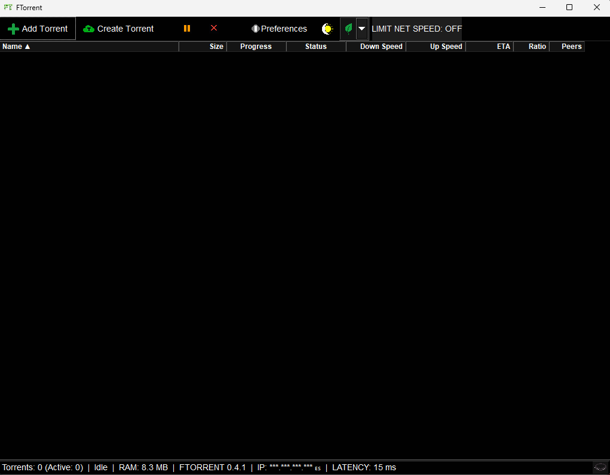

# FTorrent

A lightweight, ad-free BitTorrent client for Windows and Linux, written in **C++20** on top of **FLTK** and **libtorrent-rasterbar**. No Electron, no bundled browser, no telemetry.

[](https://opensource.org/licenses/MIT)
[](https://github.com/thedevil4k/FTORRENT/releases)
[](https://github.com/thedevil4k/FTORRENT/actions/workflows/build.yml)
[](https://github.com/thedevil4k/FTORRENT/stargazers)
[](https://github.com/thedevil4k/FTORRENT/releases)



> [!TIP]
> ### [Download the latest release](https://github.com/thedevil4k/FTORRENT/releases)
> Windows releases ship as a ZIP, Linux as Arch, Debian and RPM packages.

---

## What it does

**Torrents**
- Add a `.torrent` file, a folder or a magnet link — or drop them onto the list window
- Create a `.torrent` from a folder
- Pause and resume per torrent, remove with confirmation
- Sortable list with name, size, progress, status, down speed, up speed, ETA, ratio and peers

**Speed and resource control**
- One-click **50 % rate limit** for the session (magenta when active), released back to your configured limits
- RAM usage mode: **ECO** (zero buffer), **NORMAL** (balanced), **TURBO** (max buffer)
- Global up/down rate limits, connection limits and listen port in Preferences

**Search**
- Search torrents from the toolbar across SolidTorrents, BitSearch, Nyaa.si, The Pirate Bay (HTML and its apibay API), BTDig and Pirate Face — with a proxy/mirror fallback wherever the site offers one
- A status dot next to each engine: green = reachable, red = unreachable, gray = not checked yet (checked once per session, in the background, when you first open search)
- Picking a site in the dropdown queries **that site only**; the app never widens a search the user did not widen. **All engines** is an explicit first row that asks every enabled site at once, each in its own worker, with rows appearing as each one answers. A slow or blocked site costs its own line in the status bar and never holds up the rest, and the table is repainted once per burst of arrivals, not once per row
- Expand any result to see the files it downloads before downloading anything; names are shown in full whenever the window has room. When the site offers a `.torrent` link it is used directly, and its info hash is checked against the magnet so a mirror serving a different file is never shown as that row; otherwise the app asks the swarm, keeping every tracker the magnet came with and adding a few public ones for the sites that publish none. Expanding more results than can run at once queues them instead of dropping the click, and a swarm that does not answer says what the trackers and the DHT did. A torrent whose known file list contains a compressed package, a disc image (`.iso`/`.dmg`/`.img`), a video or a native Windows/Linux executable shows its badge right after the shield, before the name, in that order; when the on-demand archive check reads an index whose entries ask for a password (a RAR or ZIP file header carrying the encryption flag), a green lock is drawn between the archive and the disc-image badges and the row never pretends the content was inspected. A title that merely ends in an archive, disc-image or executable extension shows the same badge dimmed, so a hint is visible without passing for a fact — the lock has no title form, because a name cannot say whether an archive is encrypted. Video is badged only when the real file list contains one, and scripts or bytecode (`.jar`, `.py`, `.sh`, `.dll`…) never get the executable badge. Badges stop being added before the name would become unreadable
- Double-click a result (or press Enter) to download it; multi-file magnets offer one checkbox per file, so you fetch only what you want
- Per-site categories and result pages, shown in a dedicated view with a **Back to my torrents** return

**Network monitor** — the globe button opens what the engine is connected to: every peer link with its torrent, address, port, direction, encryption state, client, rates and progress, plus the events libtorrent reported (peers banned, invalid requests, torrent, file and tracker errors). It shows the connections FTorrent has, not packet contents: there is no capture in this build.

**Preferences** — five tabs: General (download path, autostart, tray, public IP), Connection (listen port, rate and connection limits), BitTorrent (DHT, PEX, LSD, UPnP, NAT-PMP), Advanced (user agent, anonymous mode), Security (VirusTotal API key and MalwareBazaar Auth-Key, stored by the OS rather than in `settings.ini`).

**Security analysis before downloading**
- Every surface warns before the download starts: a shield next to the torrent name in search results, Add Torrent, the torrent list and Details
- Expanding a search row shows a risk summary and per-file tags such as `EXE`, `SCRIPT`, `ARCHIVE`, `DOUBLE EXT`, `PATH`, `SYMLINK` or `HIDDEN`
- The Add Torrent dialog analyzes the files that are currently checked, offers **Select only non-executables**, and asks for confirmation before a High/Critical selection is accepted
- Details gains a **Security** tab with the report and every finding; the Files tab tags each entry with the same metadata analysis
- The analysis is metadata only: names, executable/hidden/symlink flags and symlink targets. No file contents are read, nothing is uploaded and no telemetry is sent
- A clean report says **no known indicators**, never “safe”. When there is no file list yet, the shield stays **Unknown** instead of guessing
- **Reputation by hash, on request.** Clicking a shield asks VirusTotal and MalwareBazaar about the file's SHA-256, and only then. The hash comes from the torrent metadata; when the metadata does not carry a whole-file hash and the file is already complete on disk, FTorrent hashes it locally and asks about that, without uploading anything. Otherwise it says exactly `VT no disponible antes de descargar el archivo completo.` instead of downloading the file to compute one
- **Archives without the archive.** For a RAR or ZIP, **Check archive** reads the archive index from a temporary folder that is deleted immediately, lists the entries and reports whether anything inside can run; the answer comes with the entry list itself (path, size and tags such as `[EXE]` or `[ENCRYPTED]`), eight lines in the search row and all of them in Details. Available from a search row, Add Torrent and Details
- Both providers need a key: VirusTotal's API key and the abuse.ch Auth-Key that MalwareBazaar now requires (it answers HTTP 401 without one). Keys never live in `settings.ini`: they are stored with Windows DPAPI, or in 0600 files on Linux, from Preferences ▸ Security, which also has a **Get free key** button for each provider. A provider without a key is skipped and the other is still asked. No key is ever shipped with FTorrent: a key inside a distributed binary is extracted in seconds, and both providers issue them per account
- The former post-download VirusTotal and RAR/ZIP inspection actions remain retired; `FileHash`, `ArchiveInspector` and `VirusTotal` stay as internal engines for the pre-download analysis
- Archive support is optional at build time

### Archive formats

**Check archive** never downloads the archive itself, so what it can list depends on where the format keeps its index:

| Format | What you get | How it is read | Enabled today |
| :--- | :--- | :--- | :--- |
| ZIP | the complete list | central directory at the end (two pieces) | yes |
| RAR5 (RAR 5.0 and later) | the complete list | headers at both ends (two pieces) | yes |
| RAR 1.5–4.x | a **partial** list, labelled as such | headers walked one by one, packed data skipped, bounded to a tenth of the archive's pieces (64 at most) or to the deadline | yes |
| 7z | candidate for a complete list | metadata sits at the end and may be compressed, so it needs its own bounded read rather than two pieces | no |
| CAB | candidate for a complete list | file entries follow the header at the start | no |
| TAR (uncompressed), ARJ, LZH | partial, like old RAR | headers interleaved with the data | no |
| single-file `.gz`, `.bz2`, `.xz`, `.zst` | not listable | one stream, no index | no |

The extension only says `.rar`; the version comes from the file's signature (`RAR!` plus `0x01 0x00` is RAR5), which is why the variant is named after the index has been read. An archive whose headers are encrypted cannot be listed at all and is reported as password-protected, not as broken.


**Interface**
- Dark and light themes; dark is the default and theme choice is per session
- Censorship toggle in the status bar, to hide sensitive fields from screenshots
- Status bar with torrent counts, RAM, version, connection latency and — only if you ask for it — your public IP

---

## Building from source

Requires **CMake 3.15+**, a C++20 compiler (GCC 11+, Clang 14+ or VS 2022), **FLTK**, **libtorrent-rasterbar**, **OpenSSL**, zlib, libpng and libjpeg. **libarchive** is optional and backs the internal read-only RAR/ZIP engine.

```bash
# Linux — installs every build and test dependency first
./scripts/linux/setup/setup-linux.sh

cmake -S . -B build -DCMAKE_BUILD_TYPE=Release
cmake --build build -j"$(nproc)"
./build/FTorrent
```

```powershell
# Windows — installs vcpkg dependencies first
.\scripts\windows\setup-windows.bat

cmake -S . -B build -DCMAKE_BUILD_TYPE=Release
cmake --build build --config Release
```

The app resolves its `assets/` folder next to the executable, so run the binary from the build tree or copy `src/assets/` beside it.

Full step-by-step instructions: **[COMPILE-GUIDE.md](COMPILE-GUIDE.md)**. Packaging and installers: **[scripts/BUILDING.md](scripts/BUILDING.md)**.

## Tests

The suite is CTest-based and off by default, so a normal build stays a plain app build with no test-only dependencies.

```bash
bash scripts/linux/tests/run-tests.sh        # configure, build and run the offline suites
bash scripts/linux/tests/run-tests.sh --all  # include `flows`, which needs the network
```

That is the same three steps CI runs, and on a machine without a graphical session it wraps the run in `xvfb-run`, so the suites still have the display FLTK asks for. By hand, the same thing is:

```bash
cmake -S . -B build -DFTORRENT_BUILD_TESTS=ON
cmake --build build
ctest --test-dir build --output-on-failure
```

| test | what it covers |
| :--- | :--- |
| `toolbar_layout` | toolbar geometry and the level thresholds across every width from 400 to 1920 px |
| `toolbar_clicks` | every toolbar button hit-testable and clickable at the narrowest supported width, plus opening/closing the search view, the engine status dots and a clean, segfault-free shutdown |
| `icons_full` / `icons_missing` | icon rendering, toolbar levels and spacing, with and without the on-disk assets |
| `flows` | preferences, add, remove, rate limit, search, file lists, pause/resume end to end |
| `file_hash` | SHA-256 vectors and VirusTotal URL validation |
| `archive_inspector` | read-only listing and hashing inside a generated ZIP and the RAR5/ZIP fixtures, plus its refusals for bad input (built when libarchive is found) |
| `security_analyzer` | metadata heuristics: file families, hostile names, symlinks, torrent-level counts and the non-verdict wording |
| `security_badge` | risk labels/palette, name sanitising and the rendered shield |
| `security_keys` | the key store: round trip, removal, per-file separation and the absence of the key from the stored bytes |
| `reputation` | provider parsing from canned answers, the service's states and wording, and the exact no-hash sentence |
| `archive_preflight` | piece arithmetic, sparse head+tail assembly, and a real ZIP/RAR5 listing rebuilt from only its two ends |
| `security_events` | the engine event log: order, the capacity cap and which end it drops |
| `search_results` | batched rows accumulate instead of replacing, and the sorted view follows the sort column as rows land |
| `search_scope` | picking a site asks exactly that one engine; All engines is explicit |
| `search_parse` | a published magnet keeps its `tr=` trackers, each row gets its own `.torrent` link, and a relative link is never guessed |
| `filelist` | the trackers and DHT nodes every probe uses, `.torrent` hashing and the sample-torrent parser |
| `filelist_network` | against the real swarm: Nyaa's `.torrent`, the hash check that refuses a different torrent, a trackerless Pirate Bay magnet reaching its peers, and the wording of an empty swarm |

`flows` and `filelist_network` touch the network and are labelled `network`; drop them with `ctest --test-dir build -LE network` for an offline run. Tests redirect the settings directory to their own scratch space and never read or delete yours.

CI builds and runs the offline subset on pushes and pull requests that touch code; see [.github/workflows/build.yml](.github/workflows/build.yml).

---

## Repository layout

| path | contents |
| :--- | :--- |
| `src/` | the application: `MainWindow`, `TorrentSession`/`TorrentManager`, `SearchEngine`, `PreferencesDialog`, `AssetLoader`, `Resources`, `ToolbarLayout` |
| `tests/` | the CTest suite |
| `scripts/` | dependency setup, compilation and packaging scripts per platform |
| `docs/` | the public site sources (`index.html`) and its assets |
| `packaging/` | Arch, deb and rpm packaging |

Architecture notes live in **[ARCHITECTURE.md](ARCHITECTURE.md)**.

---

## Documentation

- **[FUTURE_UPDATES_IDEAS.md](FUTURE_UPDATES_IDEAS.md)** — evaluated ideas we parked (and why), in Spanish and English
- **[USER-GUIDE.md](USER-GUIDE.md)** — using the client
- **[ARCHITECTURE.md](ARCHITECTURE.md)** — how the code is put together
- **[UI-DESIGN.md](UI-DESIGN.md)** — interface and layout rules
- **[MULTITHREADING-ARCHITECTURE.md](MULTITHREADING-ARCHITECTURE.md)** — the asynchronous core
- **[TECHNICAL-REFERENCE.md](TECHNICAL-REFERENCE.md)** — developer reference
- **[DEPLOYMENT.md](DEPLOYMENT.md)** — releases and packaging

---

## What changed recently

- **Toolbar rebuilt around one owner.** Bar and button sizes, spacing, the three toolbar levels and the centring arithmetic all live in [`src/ToolbarLayout`](src/ToolbarLayout.h), a policy module with no FLTK dependency. The bar is centred at every width from the 720 px minimum upwards, and the child count that `requiredWidth()` multiplies by the gap is derived from the same table that sizes the widgets, with a startup check that aborts if the pack ever disagrees.
- **Assets load from disk with a compiled-in fallback.** [`AssetLoader`](src/AssetLoader.h) provides the toolbar PNGs at the right size; if one is missing, the built-in glyph is used instead, so a button is never blank. The XPM glyphs are resampled to 26 px at startup rather than scaled by the widget.
- **Public IP in the status bar is off by default.** A new installation does not look its address up online until you tick the box; an existing `ShowPublicIp=true` is left alone.
- **The 50 % rate limit button says so.** Its tooltip now reads `Limit network speed 50%`.
- **A test suite in the repository.** CTest programs built from the same objects the app ships.
- **Post-download security UI retired.** The Details window no longer offers “Open in VirusTotal” or “Inspect Archive”. `FileHash`, `ArchiveInspector` and `VirusTotal` stay as internal engines for the pre-download analysis; no file is uploaded and no telemetry is sent.
- **Metadata risk analysis before downloading.** A shield now sits next to the torrent name in search results, Add Torrent, the torrent list and Details. Expanding a search row shows the risk summary and per-file tags; Add Torrent analyzes the checked files and can select only non-executables; Details has a Security tab. The analysis reads names and metadata only, and says “no known indicators” rather than “safe”.
- **The hash is always on show.** Every expanded result, the Security tab of Details and the Add Torrent panel print the whole-file **SHA-256** the metadata carries, with the file it belongs to, or say plainly that the metadata has none and that the file is never downloaded just to compute one. That line does not depend on a provider answering: the user is entitled to know which hash was used

- **Reputation and archive checks, on demand.** Clicking a shield looks the file's SHA-256 up in VirusTotal and MalwareBazaar; **Check archive** reads a ZIP or RAR index without downloading the archive. Neither runs without a click, neither uploads anything, and without a whole-file hash FTorrent says so plainly instead of downloading the file.
- **Network monitor.** The toolbar globe shows every peer link and the events the engine reported, with no packet capture and no claim to one.
- **One version, one place.** `project(FTorrent VERSION ...)` feeds the user agents through `src/Version.h`; a release bumps one number, and the `security_events` suite fails if the definition stops reaching the code.
- **Both checks reach every surface.** Search rows offer the archive check under the expanded file list, Details has a **Check archive** button on its Security tab, and a completed file with no metadata hash is hashed on this machine and looked up only when the user asks. The local hash is described as local in the answer.
- **Search engines report their reachability.** A green, red or gray dot next to each engine in the dropdown, probed once per session with no new dependencies.
- **Magnets can be picked file by file.** The Add dialog lists a magnet's already-resolved files with one checkbox each; the file rows under each result are separated so multi-file torrents read clearly.
- **Search results survive small windows and use wide ones.** Names ellipsize by pixels (full name when it fits), double-click and Enter both download, and cancelling the dialog keeps the results.
- **Probe threads shut down cleanly.** Engine checks are joinable workers instead of detached threads, which fixes an exit segfault the suite caught; `FUTURE_UPDATES_IDEAS.md` parks what we evaluated and deferred.
- **Expanding a result finds the file list again.** The generic parser was rebuilding every magnet from its info hash, which threw away the trackers the site published and left live swarms looking dead; the link is now kept as published. Nyaa.si, BitSearch and SolidTorrents also publish a `.torrent` button, which is now used first and accepted only when its info hash matches the magnet. The probe adds public trackers for trackerless magnets, bootstraps the DHT against nodes that actually answer, queues expansions beyond the four that can run at once instead of dropping the click, and names what the trackers and DHT did when nobody answers.

## License

Distributed under the MIT License.